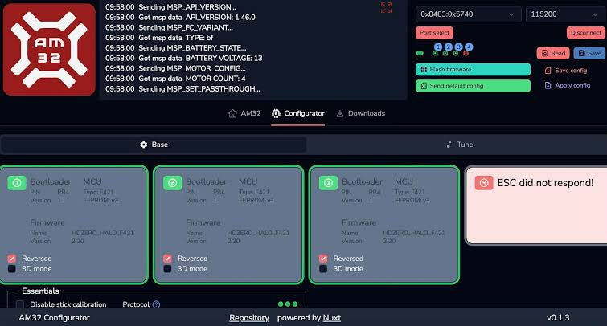
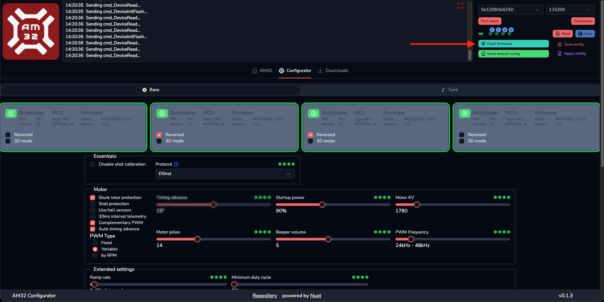
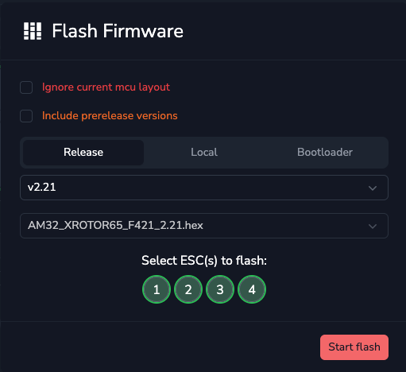
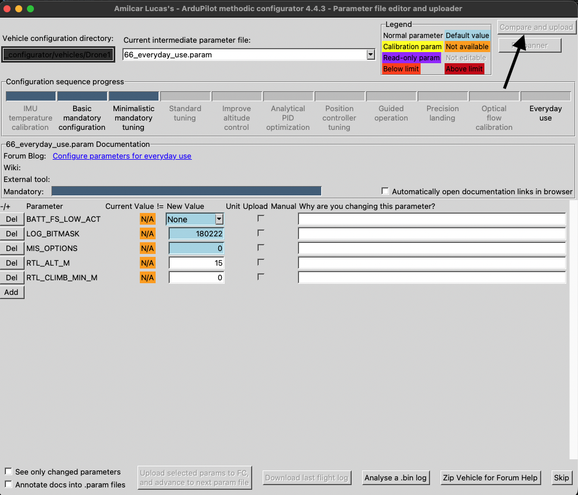

# Guide to Unlock a Stuck AM32 4-in-1 ESC

If an AM32 ESC became stuck, stopped being detected, or stayed in bootloader mode while you were flashing or upgrading its firmware, there are a few ways to recover it.

The first method uses AM32 Configurator passthrough through the flight controller.
It does not require an STM programmer, so try it first.

The second method is to manually program the affected ESC using an ST-Link or another compatible STM programmer.
This requires physically connecting the programmer to the ESC.
Attempt it only if you are comfortable with precise soldering and the risk of damaging the ESC.
See [If You Have an STM Programmer](#if-you-have-an-stm-programmer).

## Before Starting

Keep the propellers removed from the vehicle throughout this process.

There are two approaches, depending on the flight controller firmware.
The first uses ArduPilot; the second temporarily uses Betaflight.

Start with the ArduPilot method.
If the ESC still cannot be accessed through ArduPilot, use the Betaflight method.

### Requirements

Before using the AM32 Configurator through ArduPilot, ensure that the following requirements are met:

- The ESCs must be connected to DShot-capable FMU/AUX outputs.
- ArduPilot passthrough does not work through IOMCU-controlled MAIN outputs.
  Use supported FMU/AUX outputs instead.
- ArduPilot firmware 4.5 or later is required when using the web-based ESC configurator.
- The flight controller must be configured to use a DShot protocol.

Output availability and DShot support vary between flight controllers.
Check the flight controller's documentation before connecting the ESCs.

For further information, see the [ArduPilot BLHeli/AM32 passthrough documentation](https://ardupilot.org/copter/docs/common-blheli32-passthru.html).

## ArduPilot Method

Flight controllers differ in how well they pass AM32 communications to the ESCs.
Try this method first; if the ESCs cannot be accessed, use the Betaflight method.

Try these settings so that ArduPilot sends the correct signals for AM32 communication.

Connect the FC to your computer through USB and open Mission Planner.

Before changing parameters, record the current values of `MOT_PWM_TYPE` and `SERVO_BLH_AUTO`.
For QuadPlane, use `Q_M_PWM_TYPE` instead of `MOT_PWM_TYPE` for the QuadPlane motors.
You will restore them after recovery.

Open the full parameter list and set the following parameters:

`MOT_PWM_TYPE` should be set to `DShot600`.

`SERVO_BLH_AUTO` should be set to `1`.

After writing the parameters, reboot the flight controller.
Then close Mission Planner, AMC, and any other software that could keep the serial port open.
An open connection can prevent the AM32 Configurator from accessing the flight controller.

Now connect the main battery to power the ESCs.

Open the [AM32 Web Configurator](https://am32.ca/configurator) in a browser that supports Web Serial, or use a desktop configurator from the [AM32 project](https://github.com/am32-firmware/AM32#firmware-release--configuration-tool).

Select the flight controller's port with **Port select**, then connect and click **Read**.
If the ESCs are detected, continue with [Flash the AM32 firmware](#flash-the-am32-firmware).
After flashing, close the configurator, reconnect with Mission Planner, restore the parameter values recorded above, write them, and reboot the flight controller.

If the ESCs are not detected, continue with the [Betaflight method](#betaflight-method).

For background, see ArduPilot's [AM32 ESC documentation](https://ardupilot.org/copter/docs/common-am32-escs.html) and [Mateksys H743-WING documentation](https://ardupilot.org/copter/docs/common-matekh743-wing.html).

## Betaflight Method

If the ArduPilot method does not allow the ESCs to be accessed, temporarily flash Betaflight firmware to the flight controller and use its passthrough.

If you used the Betaflight method:

Before flashing, connect AMC to the flight controller once more so it downloads the latest parameters.
Then copy the newly updated `complete.param` file from your AMC vehicle directory to a safe location.
You will use it to restore the ArduPilot parameters.

Flash the Betaflight firmware target for your exact flight controller.
Follow that board's instructions to enter DFU mode; on many boards, this means holding the DFU/BOOT button (or bridging the BOOT pads) while connecting USB.
Disconnect the main battery before flashing.
Keep the flight controller connected to USB and powered through USB during the firmware flash.

Open Betaflight Configurator and select a DShot protocol for the ESCs.
Save the configuration, close Betaflight, and disconnect USB.

Reconnect the flight controller to USB without the main battery and let it boot.
Open the AM32 Web Configurator or desktop configurator and use **Port select** to choose the flight controller's USB port.

The next step needs to be performed quickly.
Connect the main battery and immediately click **Connect** in the AM32 Configurator.
This prompts it to communicate with the ESC before the ESC finishes its normal startup.

If the ESCs are not detected, disconnect the battery and USB, then try again.
On each attempt, reconnect the battery and click **Connect** almost simultaneously.
Repeat until the configurator detects the ESCs.

Click **Read**.
If the connection succeeds, the detected ESCs will appear in the configurator.
Then [flash the AM32 firmware](#flash-the-am32-firmware).

### Flash the AM32 firmware

After the configurator connects to the ESCs, click **Flash firmware**.
If the button is disabled, confirm that the ESCs were detected and read.

Select the ESC or ESCs to recover.
For a 4-in-1 ESC whose four ESCs use the same target, select all four.

Choose a stable firmware release and the `.hex` firmware file whose target matches the ESC's MCU and layout.
Leave **Ignore current mcu layout** and **Include prerelease versions** unchecked unless the ESC manufacturer's instructions specifically require otherwise.
If you are unsure which target file matches your ESC, stop and check with the ESC manufacturer before flashing.

Start the flash and wait for it to finish.
Do not refresh the browser, disconnect USB, or remove power while the firmware is being written.
Afterward, verify that the ESCs are detected and can be configured.

### Restore ArduPilot

If you used the Betaflight method:

Disconnect the main battery.
Restore ArduPilot firmware for the exact flight controller model.
Follow the [ArduPilot firmware flashing guide](https://ardupilot.org/copter/docs/common-loading-firmware.html) and the board-specific instructions to enter DFU mode.
When the board needs DFU flashing, use the matching `*_with_bl.hex` file with the documented DFU tool; use the ground-station method and `.apj` file if the board still has
an ArduPilot-compatible bootloader.

After ArduPilot starts, reopen the vehicle in AMC and use **Compare and upload** to upload the saved `complete.param` file.
Check that `MOT_PWM_TYPE` and `SERVO_BLH_AUTO` match the values you recorded; restore them in Mission Planner if needed.
Reboot and verify the vehicle configuration before reconnecting the main battery.

## If You Have an STM Programmer

If the ESC cannot be recovered using the methods above and you have an ST-Link or another compatible STM programmer, the ESC can be flashed directly.

This requires connecting the programmer to the appropriate programming points on the ESC and manually flashing the AM32 bootloader or firmware.

Use the following [guide](https://oscarliang.com/flash-am32-blheli32-esc/) for the physical connection and flashing procedure.

Follow the section titled "How to Flash AM32 Bootloader".

## If Nothing Works

If the ESC cannot be detected using either the ArduPilot method or the Betaflight method, and it also cannot be programmed using an STM programmer,
there is a high possibility that the ESC has a hardware problem.
