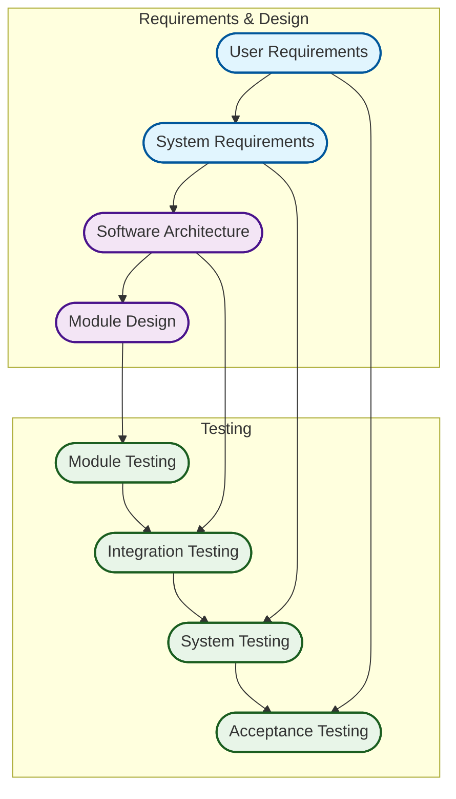

# Development history

In the beginning of the development of this software we used development techniques from the automotive industry.
We used the [standard V-Model software development method](https://en.wikipedia.org/wiki/V-model_(software_development)).
It was augmented with [DevOps](https://en.wikipedia.org/wiki/DevOps) and [CI/CD automation](https://en.wikipedia.org/wiki/CI/CD) practices at a later stage.

## V-model

Development started by using the classic V-model development methodology.

If the diagram above does not display correctly, [see here](https://github.com/ArduPilot/MethodicConfigurator/blob/master/ARCHITECTURE.md#v-model)
