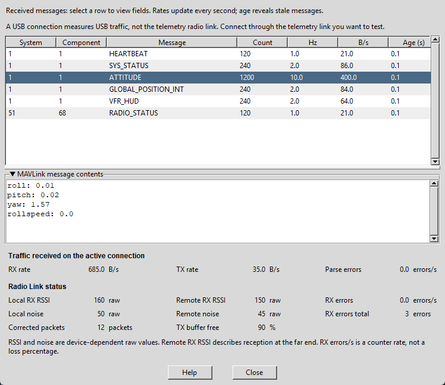
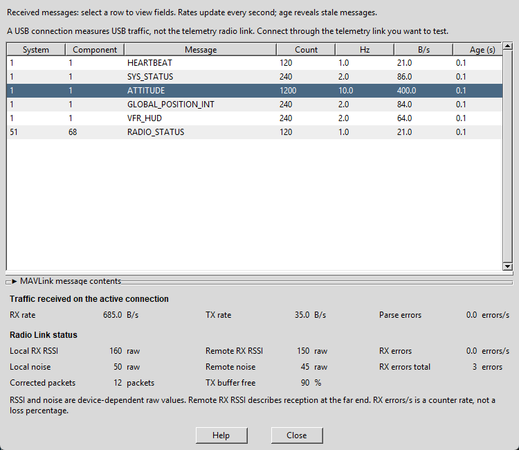
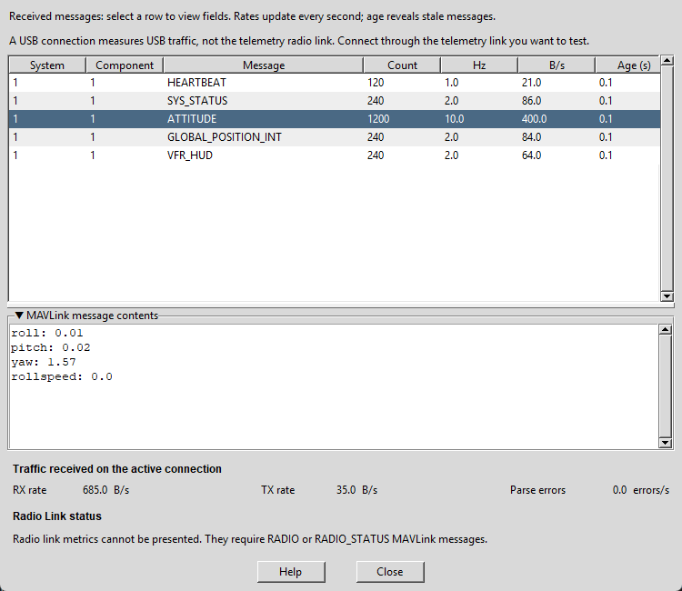

# MAVLink Inspector User Manual

The **MAVLink inspector** helps you check whether your computer is receiving
information from an ArduPilot vehicle and see what that information contains.
ArduPilot runs on the vehicle's **flight controller**. **MAVLink** is the message
format it uses to communicate with ground software, including ArduPilot
Methodic Configurator (AMC).

You do not need to understand every message to use this tool. Start by checking
that message counts increase and that recent messages keep arriving.
The inspector observes the current connection; selecting rows and sorting
columns does not change vehicle parameters.

## Contents

1. [Before you start](#before-you-start)
1. [Open the inspector](#open-the-inspector)
1. [Read the message table](#read-the-message-table)
1. [Inspect message contents](#inspect-message-contents)
1. [Understand connection traffic](#understand-connection-traffic)
1. [Understand radio link status](#understand-radio-link-status)
1. [Try a simple connection check](#try-a-simple-connection-check)
1. [Troubleshooting](#troubleshooting)
1. [Help and closing the window](#help-and-closing-the-window)

## Before you start

- Remove propellers and keep the vehicle disarmed during bench checks.
- Connect and power the flight controller, and let it finish starting up.
- Choose the connection you want to examine: USB, a telemetry radio, or a
  network connection. USB traffic does not measure a separate wireless link.
- If another application already owns the serial port, close its connection
  or use the [MAVLink forwarding instructions in the main manual](USERMANUAL.md#connecting-amc-through-mission-planner-mavlink-forwarding).

The inspector observes traffic reaching AMC through its **active connection**.
System and component numbers identify message senders; they are not flight
controller serial-port numbers. To check another physical telemetry link,
close the inspector, change AMC's connection, and open the inspector again.

## Open the inspector

In AMC's Parameter Editor, click **MAVLink inspector**, directly below
**Zip vehicle for Forum help**. A live flight-controller connection is required.

You can also run the installed inspector independently of the main application:

```powershell
amc_mavlink_inspector
```

Choose a connection if prompted. For a known serial port, you can specify it:

```powershell
amc_mavlink_inspector --device COM5 --baudrate 57600
```

Replace `COM5` with your own port and `57600` with your telemetry radio's serial
baudrate. That number is a connection setting, not the measured received data
rate. Developers running from a source checkout can use:

```powershell
python -m ardupilot_methodic_configurator.frontend_tkinter_mavlink_inspector
```

The standalone inspector does not require a vehicle project or a parameter
download. Use `amc_mavlink_inspector --help` to see its connection options.

## Read the message table



*These screenshots use illustrative values rather than a connected vehicle.
Your message names, rates, and radio readings will differ.*

Each row represents one message type from one sender:

For an explanation, hover over a column heading or a value in that column.
Tooltips explain the units and available actions in plain language. You can
also hover over the radio labels, readings, units, scrollbars and buttons.

| Column | Meaning |
| --- | --- |
| System | The sender's MAVLink system number. |
| Component | The sender's component number within that system. |
| Message | The kind of information received, such as `HEARTBEAT` or `ATTITUDE`. |
| Count | How many messages of this type the monitor has observed from this sender. |
| Hz | Recent messages per second; `10.0` means about ten each second. |
| B/s | Recent received bytes per second for this row. |
| Age (s) | Seconds since the most recent message in this row arrived. |

Click a column heading to sort. Click it again to reverse the order. Sorting
**B/s** helps you find which messages use the most bandwidth. Alternating row
backgrounds make it easier to follow a row across the table.

Rates need a short observation interval before they settle. A growing **Count**
and a small **Age (s)** show that messages are arriving. If a message stops,
its age grows; after about three seconds its displayed rates become zero.
The old row and last contents remain available for inspection.

## Inspect message contents

Select a row to see its latest decoded fields under **MAVLink message contents**.
For example, `ATTITUDE` contains orientation information. Fields show the values
carried in the message; they are not editable parameter settings.

Units and number scales depend on the message. For unfamiliar fields, look up
the message name in the [MAVLink message reference](https://mavlink.io/en/messages/common.html).

Drag the horizontal separator to give more height to the table or the contents.
Click the **MAVLink message contents** title to collapse it. The table expands
into the freed space, while the connection and radio status footer stays visible.
Click the title again to restore the contents.



## Understand connection traffic

The notice near the top of the inspector reminds you that a USB connection
measures USB traffic, not the telemetry radio link. To measure the radio path,
connect AMC through that telemetry link before opening the inspector.

The footer's **Traffic received on the active connection** section summarizes
the connection AMC is monitoring:

- **RX rate**: bytes received by AMC per second.
- **TX rate**: bytes sent by AMC per second.
- **Parse errors**: decoding errors observed by AMC per second.

**RX** means receive; **TX** means transmit. These are measured traffic rates,
not the connection's maximum speed. The message table lists received messages;
the TX summary does not add transmitted-message rows to that table. A zero TX
rate can be normal while the inspector is only listening.

**Unavailable** means there is no current measurement or not enough data to
calculate it. It is different from a measured zero.

## Understand radio link status

### When radio reports are missing



If the connection has no current `RADIO` or `RADIO_STATUS` report, the inspector
hides the three columns of radio metrics and displays:

> Radio link metrics cannot be presented. They require RADIO or RADIO_STATUS MAVLink messages.

Receiving other vehicle messages can still be working normally. For example,
a direct USB connection may have no radio modem report. Check the message
table for incoming messages before assuming that the whole connection failed.

### When radio reports arrive

The three columns appear automatically when a current report arrives, with an
explanation underneath. Both the explanation and the missing-report message
wrap to the window's available width.

| Metric | How to read it |
| --- | --- |
| Local RX RSSI | Signal strength at the reporting radio. |
| Remote RX RSSI | Signal strength at the other end of that radio link. |
| Local noise / Remote noise | Background radio noise at each end. |
| RX errors | Increase in the radio's receive-error counter per second. |
| RX errors total | The radio's reported receive-error counter. |
| Corrected packets | Packets the radio reports as corrected by its error correction. |
| TX buffer free | Percentage of the radio's transmit buffer that is available. |

RSSI and noise use the device's raw scale. Do not read them as percentages or
assume they are dBm. Compare readings using the same radio equipment and its
manufacturer's guidance. **RX errors/s** is a counter rate, not a packet-loss
percentage. Counters can reset when the radio restarts.

These fields come from the radio reports defined in
[RADIO_STATUS](https://mavlink.io/en/messages/common.html#RADIO_STATUS) or the
older [RADIO message](https://mavlink.io/en/messages/ardupilotmega.html#RADIO).
They do not provide a separate TX error counter. A radio may leave some fields
unknown; those fields show **Unavailable**.

The panel shows the latest current radio report received on this connection.
If a routed connection contains reports from several radios, it does not
separate them into independently selectable physical links.

## Try a simple connection check

1. Connect through the telemetry link you want to check and open the inspector.
1. Wait a few seconds. Check that message counts grow and ages stay small.
1. If radio metrics are available, note both local and remote readings.
1. With propellers removed and the vehicle disarmed, vary antenna orientation
   and separation within a safe bench-test range. Watch for changes in rates,
   errors, and radio readings.
1. Briefly interrupt the telemetry path while keeping the bench setup safe.
   Message ages should grow. Radio metrics disappear when reports become stale.
1. Restore the link and check that fresh messages and readings return.

This check helps diagnose connectivity; it does not establish a safe flight
range. Follow your radio manufacturer's range-test procedure before flying.

## Troubleshooting

| What you see | What to check |
| --- | --- |
| No message rows | Flight-controller power, connection selection, cable or radio wiring, and serial baudrate. |
| Counts stop and age rises | Whether the telemetry path was interrupted or the sender stopped that message. |
| Vehicle messages arrive but radio metrics are hidden | Whether a radio actually supplies `RADIO` or `RADIO_STATUS` on this path. |
| Some radio fields show Unavailable | Whether the device reports those fields, and whether fresh samples have arrived. |
| RX errors/s is initially Unavailable | Allow time for two suitable radio counter samples. |
| TX rate is zero | Whether AMC is currently sending anything; listening alone need not produce TX traffic. |
| Parse errors keep increasing | Connection settings and the quality of the serial or telemetry path. |

When asking for help, include your connection type, radio model if any, and a
screenshot showing message rates and ages. Explain whether the problem affects
all messages or only particular types. See [Support](SUPPORT.md) for help channels.

## Help and closing the window

**Help**, to the left of **Close**, opens the published version of this manual
in your web browser and requires an internet connection.

**Close** stops the inspector. When opened from AMC, it leaves AMC's connection
available to the main application. Closing the standalone inspector also closes
its own flight-controller connection.

[Return to the main user manual](USERMANUAL.md)
