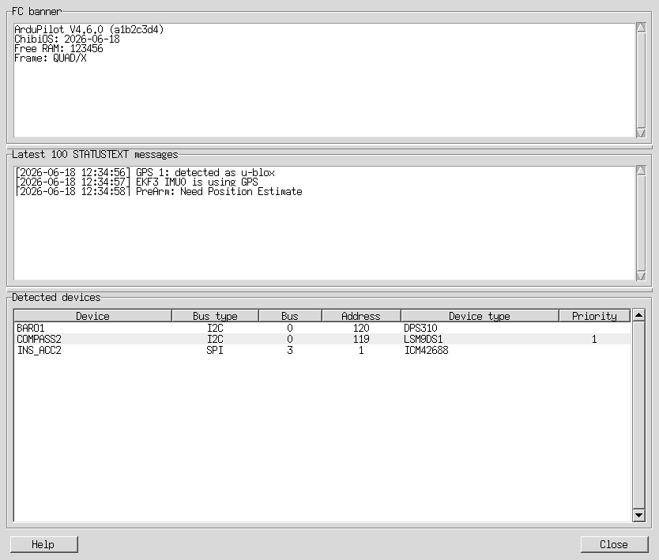

# Flight Controller Banner User Manual

The **Flight Controller Banner** window shows startup messages and recent status
messages received from the connected flight controller. It also lists detected
hardware devices derived from the controller's parameters. This information can
help identify the firmware build, understand startup or pre-arm messages, and
check which sensors the controller reports.

## Open the FC banner

In the Parameter Editor, click the **FC banner** button. The window is available
while AMC is connected to a flight controller.

*The screenshot uses illustrative values. Messages and detected devices depend
on the connected flight controller.*

## FC banner

The **FC banner** section contains startup text reported by the flight
controller. It commonly includes the ArduPilot firmware version and build
information, board or frame details, and memory information. The text is
read-only. If no banner text was captured, the window displays a notice in this
section.

## Latest STATUSTEXT messages

The **Latest 100 STATUSTEXT messages** section shows recent messages received
from the flight controller, including messages buffered before this window
opened. New messages appear automatically. Arrival times are included when
available. Startup messages that
are already shown in the banner are omitted from this list to reduce
duplication.

Messages can include normal status updates, warnings, and pre-arm checks. A
pre-arm message describes a condition that must be resolved before arming; it
does not necessarily indicate a hardware or connection failure.

## Detected devices

The **Detected devices** table lists sensors and other devices identified from
the flight controller's device ID parameters.

| Column | Meaning |
| --- | --- |
| Device | Parameter instance associated with the device. |
| Bus type | Type of bus used to connect the device. |
| Bus | Bus number reported by the device ID. |
| Address | Device address on the bus. |
| Device type | Decoded device model or type. |
| Priority | Configured compass priority, when available. |

Click a column heading to sort the table. Click the same heading again to
reverse the sort order. Hover over a cell in the **Device** column to see the
source parameter and raw device ID used to decode it. If a device ID is missing or cannot be
recognized, it is not shown as a detected device.

## Help and closing the window

Click **Help** to open this manual in your default web browser. Click **Close**
to return to the Parameter Editor.
