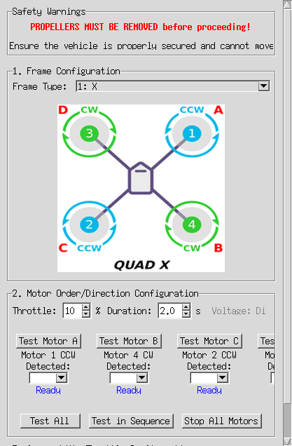

# Motor Test User Manual

The **Motor Test** window lets you select the frame type, check that every motor is connected
to the right output and spins in the right direction, and set the minimum and arming
throttle of the motors.
It requires an active flight controller connection.

> ⚠️ **PROPELLERS MUST BE REMOVED** before running any motor test, and the vehicle must be
> secured so that it cannot move. The window displays these warnings at the top.

For the implementation details see the [motor test architecture](ARCHITECTURE_motor_test.md).

## Workflow

1. **Safety setup**: remove the propellers and secure the vehicle.
2. **Frame configuration**: select the **Frame Type** that matches your vehicle.
   The motor diagram, the number of test buttons and the expected rotation directions update to match the selected frame.
   The new value is applied to the flight controller immediately, see
   [Changes that do not need an upload button](#changes-that-do-not-need-an-upload-button).
3. **Motor testing and order detection**: see below.
4. **Arm and minimum throttle**: see below.

## Testing the motors

- If the battery monitor is enabled (`BATT_MONITOR` is not 0), the window shows the battery voltage and current.
  Otherwise it shows **N/A**.
- Set the **Throttle** percentage (default 1 %) and the test **Duration** (default 2 seconds).
  Both values are remembered between sessions. Invalid entries are reset to the previous value.
- Use the **Test Motor A, B, C…** buttons to spin one motor, **Test All** to spin all motors simultaneously,
  or **Test in Sequence** to spin them one after the other.
  The first time you press a test button a safety confirmation is displayed.
- Each motor row shows its expected rotation direction (CW/CCW) and a status:
  **Ready**, **Command sent**, **Stop sent**, **Safety Check Failed**, **Invalid Parameters**, **Test Failed** or **Error**.
- Observe which motor actually spins and select it in the **Detected** drop-down.
  If it differs from the expected motor, you are asked if you want to swap the functions of the two motors.
  Correct any wiring problems if the detected order is wrong.
- The motors stop automatically after the configured duration.

### Emergency stop

Press the red **Stop All Motors** button, the **Escape** key or **Ctrl+S** at any time to stop all motors.

### Battery voltage safety check

The voltage is shown in green when it is between `BATT_ARM_VOLT` and `MOT_BAT_VOLT_MAX`
(`Q_M_BAT_VOLT_MAX` on ArduPlane), and in red when it is outside that range.
If you start a motor test while the voltage is outside the range, the test is refused and a warning asks you to
connect a properly charged battery and to check those parameters.

## Arm and minimum throttle

**Set Motor Spin Arm** and **Set Motor Spin Min** open a dialog to set `MOT_SPIN_ARM` and `MOT_SPIN_MIN`
(`Q_M_SPIN_ARM` and `Q_M_SPIN_MIN` on ArduPlane).
The dialog shows the current value and rejects invalid values.
`MOT_SPIN_MIN` must be at least 0.02 higher than `MOT_SPIN_ARM`.

## Changes that do not need an upload button

`FRAME_TYPE`, `MOT_SPIN_MIN`, `MOT_SPIN_ARM` and the motor swap are exceptions: they are written to the flight
controller as soon as you select or confirm them, **without pressing either of the two upload buttons** in the parameter editor.
Confirming a swap of two motors in the **Detected** drop-down exchanges the `SERVOx_FUNCTION` values of the two
motor outputs on the flight controller immediately.
Changing the frame type or `MOT_SPIN_ARM` also restarts the flight controller, and a progress window is shown meanwhile.
For `MOT_SPIN_MIN`, `MOT_SPIN_ARM` and the motor swap the parameter table is also updated, so the new values are shown
as already present on the flight controller.

All other edits in the parameter table stay there until you explicitly press one of the two
available upload buttons.
