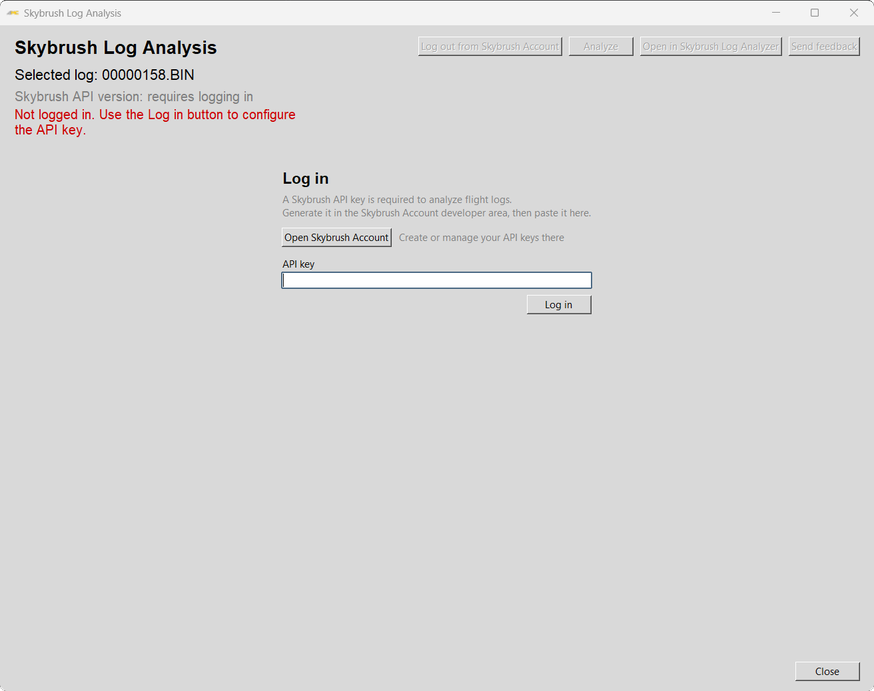
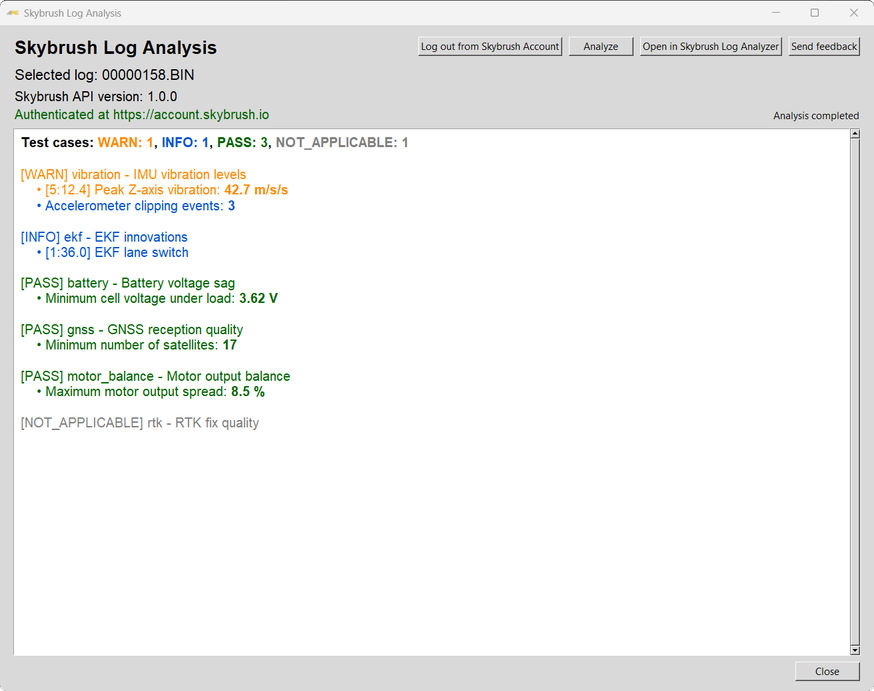
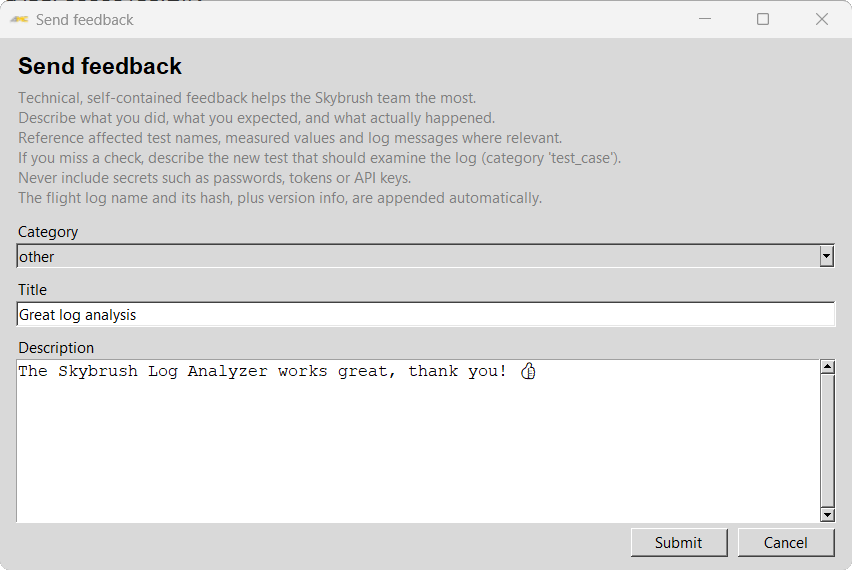

# Skybrush Log Analyzer User Manual

The **Skybrush Log Analysis** window sends an ArduPilot `.bin` flight log to the
[Skybrush](https://skybrush.io) log analysis service and shows the results inside
ArduPilot Methodic Configurator (AMC). The service runs a set of automated checks
on the log and reports the result of each one, which helps you spot problems such
as high vibration levels before the next flight.

The analysis runs on the Skybrush servers. Using it requires an internet
connection and a Skybrush Account, and the selected log file is uploaded to the
Skybrush service.

## Open the window

In the Parameter Editor, click **Analyse log with Skybrush** and select a `.bin`
flight log. The Skybrush Log Analysis window opens for that log. The selected
log name is shown at the top of the window.

## Log in

The first time you open the window, it asks for a Skybrush API key.

1. Click **Open Skybrush Account** to open the Skybrush Account website in your
   web browser.
1. Create an API key in the developer area of your account and copy it.
1. Paste the key into the **API key** field and click **Log in**.

AMC checks the key and stores it, so you stay logged in the next time you open
the window. Click **Log out from Skybrush Account** to remove the stored key.

## Analyze a log

Click **Analyze** to upload the selected log and run the analysis. This can take
a while for large logs.

*The screenshot uses illustrative results. The checks and values depend on the
analyzed log.*

The results start with a summary of how many checks ended with each status,
followed by one entry per check, the most severe ones first. Each entry can list
messages with measured values and, where available, the time in the flight when
they occurred. The colors show the status:

| Status | Meaning |
| --- | --- |
| FAIL | The check found a problem that should be fixed. |
| WARN | The check found something that should be reviewed. |
| INFO | Informational result. |
| PASS | The check passed. |
| SKIP / NOT_APPLICABLE | The check did not run, or does not apply to this log. |

Press **Ctrl+F** to search the results. Use **Enter** or **F3** to go to the next
match, **Shift+Enter** or **Shift+F3** to go to the previous one, and **Esc** to
close the search bar.

## Open the analysis in the web application

Click **Open in Skybrush Log Analyzer** to open the analysis of the selected log
in the native Skybrush Log Analyzer web application, already logged in. The web
application offers more detailed views of the analysis than the AMC window and 
proides additional services related to log analysis.

## Send feedback

Click **Send feedback** to report a suspicious result, suggest a new check, or
send any other feedback directly to the Skybrush team.

Choose a **Category**, enter a **Title** and a **Description**, and click
**Submit**. The flight log name, its hash, and version information are added to
your message automatically. Do not include passwords, tokens, or API keys.

## Close the window

Click **Close** to return to the Parameter Editor.
